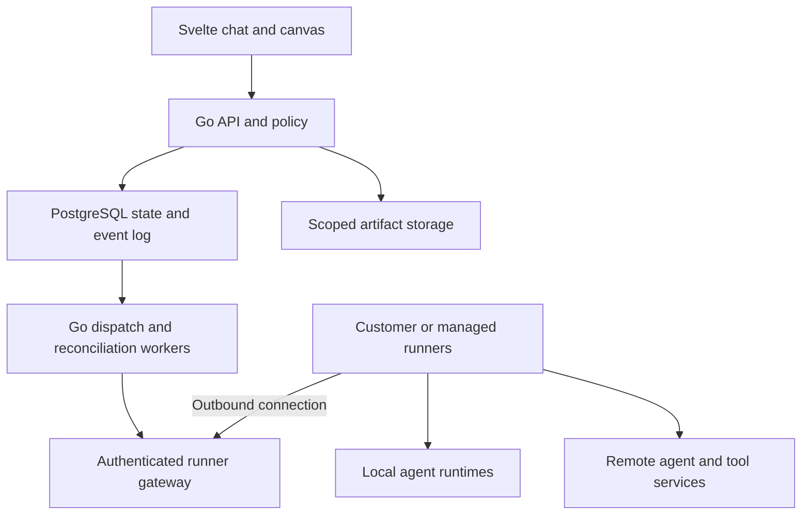

# Architecture

## Status and product boundary

This is the **target architecture**, not a description of implemented behavior. The repository has a Go HTTP scaffold, validated startup configuration, synchronous request draining, reproducible build/CI tooling and a Svelte interface shell. The optional Compose database is development infrastructure; the API does not yet use it. Stage C implements typed identities, guarded transitions, wire contracts and stateless graph validation; see [Contracts](CONTRACTS.md). Persistence, authentication, runners, connectors and orchestration remain planned.

Confignostic owns the shared chat, workflow definitions, approvals, execution history and artifact references. It coordinates independent agent runtimes through documented interfaces. Core chat, canvas, connectors, automation and collaboration remain self-hostable; managed cloud operates the same core.

Implementation order and acceptance criteria are in the [A–Z development plan](plans/DEVELOPMENT_PLAN.md). Provider scope is in the [supported-agent catalog](SUPPORTED_AGENTS.md).

## Components and trust boundaries

Start with a modular Go monolith and separate execution runners. Keep PostgreSQL as the durable source of truth. Add Redis or additional services only after a measured requirement and a recorded design decision.

Dispatch/reconciliation workers and the gateway are modules of the Go service initially. The diagram does not prescribe separate microservices. Commands and events travel over the runner-established connection in both directions.

| Component | Owns | Boundary |
| --- | --- | --- |
| Svelte UI | Conversations, graph editing, approvals, run inspection and settings. | Displays authorized state; server validates every action. |
| Go API | Identity, workspaces, policy, registry, chat, graph validation and public API. | Authentication and workspace authorization before resource access or dispatch. |
| Dispatch/reconciliation workers | Leases, outbox delivery, attempts, retries and external-state reconciliation. | Persist intent and enforce policy; cannot treat a missing acknowledgment as success. |
| PostgreSQL | Versioned definitions, tasks/attempts, events, approvals, idempotency and audit records. | All customer-owned records have workspace ownership and authorization checks. |
| Runner | Runtime startup, scoped filesystem/environment, provider connection and normalized events. | Authenticated, revocable and bound to an authorized workspace/execution scope. |
| Connector | Provider-specific protocol mapping and capability discovery. | Untrusted provider data and version differences stop at an explicit adapter. |
| Artifact store | Bounded objects and immutable content references. | Metadata authorization before reads; signed/temporary access where appropriate. |
| Managed cloud operations | Provisioning, capacity, tenant quotas, billing and service operations. | Separate operator authority and tenant workload isolation. |

## Proposed repository modules

Introduce these areas as their stages need them; do not create empty subsystem scaffolds for the whole roadmap.

- cmd/confignostic-api/ — API and background-worker process.
- cmd/confignostic-runner/ — runner process.
- internal/identity/ and internal/workspaces/ — users, sessions and membership.
- internal/registry/ and internal/connectors/ — configured agents and connector contracts.
- internal/policy/ and internal/secrets/ — action authorization and credential references.
- internal/conversations/, internal/tasks/ and internal/workflows/ — product domain and deterministic execution.
- internal/events/, internal/dispatch/ and internal/artifacts/ — delivery, reconciliation and durable outputs.
- internal/automation/ — schedule/webhook occurrences once stage U begins.
- web/src/ — Svelte feature modules sharing generated/validated API types.
- adapters/ — supervised Node.js/Python wrappers only where a provider SDK requires them.
- migrations/ — forward schema changes and documented recovery constraints.

Core workflows do not require billing modules. Hosted metering and provisioning are introduced at X with interfaces that leave self-hosted operation independent.

## Domain model

| Entity | Purpose and invariant |
| --- | --- |
| Workspace and membership | Authorization boundary; roles are checked server-side for all owned resources. |
| Project | Repository/workspace configuration, default connections and policy. |
| Catalog entry | Documentation/discovery metadata; never implies an installed connection. |
| Agent connection | Configured provider/runtime, alias, execution location, secret reference and discovered capabilities. |
| Conversation and message | Durable user/agent communication linked to actual tasks and actor identities. |
| Workflow definition/version | Editable draft plus immutable validated versions. An executing run pins one version. |
| Workflow run/node run | Runtime decisions and dependency state for one version/input snapshot. |
| Task and attempt | One logical request and its traceable execution attempts. Provider IDs are stored separately. |
| Event | Versioned typed occurrence with internal IDs, provider reference, timestamp and replay identity. |
| Approval | Reviewer identity, action digest, policy version, scope, expiry and decision. |
| Artifact | Workspace owner, content hash, type/size, provenance and storage reference. |
| Schedule/webhook occurrence | Deduplicated trigger identity that creates a workflow run. |
| Usage record | Reported quantity, provider/source, unit and measurement/estimate status. Missing data stays unknown. |

Workflow edges move validated data/artifact references. They do not turn arbitrary agent text into permissions or executable orchestration instructions.

## Task lifecycle contract

| State | Meaning | Allowed next states in the core model |
| --- | --- | --- |
| queued | Durable intent waiting for policy/capacity/dispatch. | awaiting_approval, dispatched, failed, canceled |
| awaiting_approval | A scoped approval is pending before dispatch or at a paused action. | queued or running after approval, completed/failed/canceled after a confirmed stop, cancel_requested, unknown |
| dispatched | Intent was sent; external acceptance/progress is not yet fully confirmed. | running, awaiting_input, awaiting_approval, completed, failed, canceled after confirmation, cancel_requested, unknown |
| running | The provider is executing the task. | awaiting_input, awaiting_approval, completed, failed, canceled after confirmation, cancel_requested, unknown |
| awaiting_input | The provider requires user input. | running, awaiting_approval, cancel_requested, completed/failed/canceled after confirmation, unknown |
| cancel_requested | Cancellation is requested; the provider may still be working. | canceled after confirmation, completed, failed, running if cancellation is rejected, unknown |
| unknown | The external outcome cannot currently be confirmed. | running, awaiting_input, awaiting_approval, completed, failed, canceled after reconciliation |
| completed | The documented success condition is confirmed. | Terminal for this attempt; explicit new work gets a new identity. |
| failed | A failure is confirmed and no untracked execution is assumed. | Terminal for this attempt; an allowed retry creates a traceable new attempt. |
| canceled | Cancellation/no execution is confirmed. | Terminal for this attempt. |

Stage C encodes transition guards in internal/domain/attempt.go, beyond this state-pair summary. For example, a pre-dispatch denial can finalize locally; a mid-run denial needs confirmation that the external action/run stopped. A timeout with possible ongoing external effects becomes unknown, rather than a confirmed failure.

Pause is a workflow scheduling control unless a provider explicitly supports pausing its execution. Skipped is a workflow-node outcome, not evidence that an external task was canceled. Retrying a task preserves the logical task ID and adds an attempt; terminal attempt records are immutable. Task status summarizes the active attempt: returning a failed/canceled logical task to queued requires creating an explicitly authorized new attempt, never reopening a terminal attempt.

## Dispatch, events and recovery

1. Commit the incoming message/task, policy context and outbox intent before acknowledging durable acceptance.
2. Claim dispatch with a bounded lease/fencing token. Re-check current authorization and credential/runner availability.
3. Send a stable dispatch identity; runner and connector deduplicate where possible and record provider/session references.
4. Persist normalized events before acknowledging receipt. Preserve the provider event ID and map source events to a stable internal sequence.
5. Publish browser events from durable state with replay cursors. Handle expired cursors through an explicit snapshot/reset path.
6. After a disconnect, reconcile by known provider operation/session identity. Retry only when documented semantics permit it; otherwise preserve unknown.

Delivery is at least once at transport boundaries. The implementation must not promise exactly-once effects in an arbitrary external provider. Cursor/sequence allocation and publication must not skip committed events because an earlier transaction was still pending.

Use bounded buffers, limits on event/artifact sizes, admission control and clear overload errors. A stopped browser stream must not cancel the underlying task implicitly.

## Agent integration families

| Family | Initial role |
| --- | --- |
| Codex App Server / SDK | First real coding-agent path; App Server is the initial interactive integration choice. |
| ACP over stdio | Cursor and compatible coding runtimes through local/private runners. Validate each provider and pin protocol versions. |
| Native SDK / HTTP / WebSocket | Claude, Copilot, OpenCode, OpenHands, Letta, LangGraph and other dedicated interfaces. |
| A2A | User-registered remote services, including ADK and Microsoft Agent Framework deployments. |
| Configured Grok API agent | Explicit agent loop/tool configuration; separately tracked from Grok Build. |
| Custom adapter | Same capability/task contract for user-provided services. |
| MCP / X tools | Tool access governed by the agent/runtime and workspace policy; separate from agent registrations. |

See [Connector contract](CONNECTORS.md) for the normalization boundary and qualification requirements.

## Credentials, policy and network access

The browser receives credential metadata/references after setup, not stored secret values. Runners receive narrowly scoped credentials for their connection/task. Separate key material from encrypted data and document both rotation and backup recovery.

The planner can propose actions; policy and authorized human decisions control permission. Approvals bind the concrete inputs and expiry, and are revalidated before the action. Provider permission requests must preserve their scope in the UI.

Validate agent discovery, redirect and artifact destinations. Managed cloud rejects metadata-service and unapproved private-network access. A customer private runner may access a specifically authorized private service through an explicit workspace policy. Discovery cards and tool outputs cannot broaden that policy.

A local trusted workspace runner and a hosted untrusted-code runner require different isolation profiles. Document supported guarantees. Hosted workloads require an appropriate tenant/workload sandbox boundary; sharing a worker process with filesystem conventions is insufficient.

## Repository and artifact handling

Use isolated worktrees or equivalent workspaces for concurrent coding tasks. Record base revision, produced patch/commit and artifact hash. Merge, push or publication follows explicit policy and conflict handling.

The receiving agent gets a bounded typed handoff referencing an exact artifact version. Define context selection, visibility and retention; avoid copying the entire history or every credential into downstream prompts.

Store artifact metadata in PostgreSQL and bytes through a filesystem/object-store abstraction. Authorize metadata and downloads together; sanitize previews and prevent untrusted active content from inheriting the application's origin.

## Chat, canvas and deployment

Chat and canvas use the same workflow schema, validation and execution engine. Chat planning produces a draft; the canvas edits that draft. Run history pins a version and never changes because the user edits a newer draft.

Start self-hosted distribution with versioned API/UI and runner artifacts plus PostgreSQL and documented persistent volumes. Introduce external object storage when required through the existing abstraction.

Managed cloud uses the same domain contracts while adding tenant provisioning, stronger workload boundaries, quotas, metering and operations. [Quality gates](plans/QUALITY_GATES.md) define the evidence required for both release tracks.
